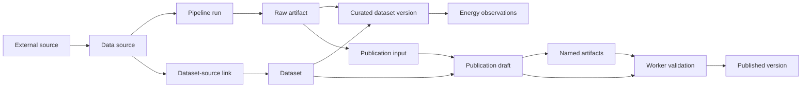

# ODIP system model

Open Data Intelligence Platform (ODIP) turns externally sourced data into identifiable, traceable datasets. Its current implementation has a catalog for sources and datasets, ingestion that captures and validates source bytes, and a publication workflow that validates versioned artifacts before making them available to consumers. A Kotlin/Spring API owns the state, a Python worker acquires and checks data, an Angular interface presents operator views, and PostgreSQL stores the catalog and lineage. Artifact bytes use PostgreSQL by default or an optional exact-version S3 backend.

This is a description of the implemented system, not an operating procedure. The energy configuration dataset is one reference profile; the core catalog, ingestion, and publication concepts are domain independent. The companion documents explain the [API](api.md) and [database schema](database.md) in more detail.

## From source to published dataset

A **data source** describes an approved external location, attribution, licensing, refresh cadence, and an optional normalizer. A **dataset** is the internal collection that can draw from one or more sources. A **pipeline run** is one attempt to acquire a source. On success, it records the captured bytes as a **raw artifact**, with a checksum, retrieval time, and optional validation result. The raw artifact is the evidence behind derived data.

The current code has two related derivation paths:

- The older curation path creates integer-numbered `dataset_version` rows and, for the implemented Eurostat renewable-share adapter, relational `energy_observation` rows.
- The publication path creates a contract-defined manifest and named artifacts in a draft. A worker validates them before the API exposes a published version identified by a public dataset ID and semantic version, such as `1.0.0`. A `dataset_publication` is a separate record and contract from an internal `dataset_version`.

The publication reference contract is pinned at **contract kit 1.0.0**. The consumer API and manifest have their own **v1** versioning; those numbers describe different things. Raw and publication artifact bytes use the implemented PostgreSQL/S3 storage abstraction. Explicit migration retains original PostgreSQL copies and verifies exact S3 object versions without changing consumer URLs, bytes or permissions. Installation activation and recovery require separate evidence; see [artifact storage](../artifact-storage.md). Parquet projections, general analytical queries and AI tools remain planned.

## Component responsibilities and trust boundary

The API owns catalog records, run and publication state, permissions, and database writes. The worker retrieves bounded HTTPS inputs, validates them, returns acquisition evidence, and claims publication jobs to validate manifests and artifacts. The browser interface is an operator view over the APIs rather than another store of record.

The hosting platform authenticates callers and applies access policies to API routes. It forwards trusted principal context to ODIP. ODIP then checks per-dataset `READ`, `WRITE`, `INGEST`, and `VALIDATE` grants for stable principal IDs. It also checks worker ownership and current claim tokens where a job has been claimed. Creating a dataset grants those four permissions to its creator; later grants are explicit. ODIP does not derive an operator role from group membership. An explicit development setting can bypass dataset grants when principal context is disabled.

Consequently, permission to reach an API route does not grant access to every dataset. Consumer reads require `READ`; ingestion and publication operations require their respective dataset grants. A source is ingestible by a principal only when it contributes to a dataset for which that principal has `INGEST`. See the [dataset access checks](../../services/platform-api/src/main/kotlin/de/eseidinger/odip/platform/publication/DatasetAccess.kt) and [trusted principal validation](../../services/platform-api/src/main/kotlin/de/eseidinger/odip/platform/security/PlatformPrincipalAuthorization.kt).
