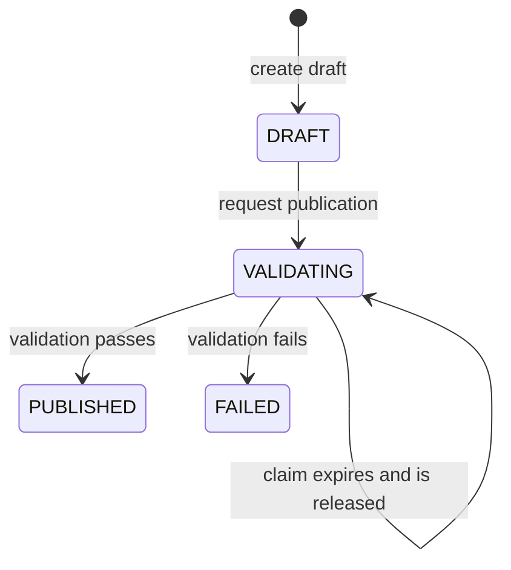

# ODIP API model

The API has two route families. `/api/...` contains the original catalog, ingestion, and energy curation endpoints. `/api/v1/...` contains the publication contract and related operator and worker operations. The distinction is visible in dataset discovery: `/api/datasets` returns internal catalog datasets identified by UUID; `/api/v1/datasets` returns published manifests with a public string ID and semantic version. For the surrounding concepts, see the [system model](README.md); for persistence, see the [database schema](database.md).

## Catalog, ingestion, and curation (`/api`)

| Routes | Meaning |
| --- | --- |
| `GET, POST /api/data-sources` | List or register source metadata. Registration checks approved HTTPS hosts; the worker also checks that resolved retrieval addresses are public. |
| `GET, POST /api/datasets` | List visible internal datasets or create one linked to registered sources. Names are unique; creation grants the creator dataset permissions. |
| `GET /api/datasets/{datasetId}/versions`, `GET /api/datasets/{datasetId}/summary` | Inspect internal curated versions and the latest version's freshness and quality summary. |
| `POST /api/data-sources/{sourceId}/ingestions`, `GET /api/pipeline-runs` | Queue an acquisition and observe run states: `QUEUED`, `RUNNING`, `SUCCEEDED`, and `FAILED`. |
| `POST /api/pipeline-runs/claim-next`, `GET /api/pipeline-runs/{runId}/job`, `POST /api/pipeline-runs/{runId}/started`, `POST /api/pipeline-runs/{runId}/completed`, `POST /api/pipeline-runs/{runId}/failed` | Worker-facing run lifecycle. Completion supplies base64-encoded bytes, length, SHA-256 checksum, optional validation/transformation information, and the current claim token. |
| `GET /api/pipeline-runs/{runId}/artifacts`, `GET /api/raw-artifacts/{artifactId}/content` | Inspect captured input metadata and retrieve its bytes, subject to source-linked dataset access. |
| `POST /api/raw-artifacts/{artifactId}/energy-observations`, `GET /api/datasets/{datasetId}/energy-observations` | The annual energy-observation curation and read model. Curation requires validated raw input. |

The older completion mapping lives with the curation adapter because it also accepts an `energyObservation` compatibility field. The [catalog controllers](../../services/platform-api/src/main/kotlin/de/eseidinger/odip/platform/catalog/web/), [ingestion controller](../../services/platform-api/src/main/kotlin/de/eseidinger/odip/platform/ingestion/web/IngestionController.kt), and [curation controller](../../services/platform-api/src/main/kotlin/de/eseidinger/odip/platform/curation/web/EnergyCurationController.kt) define the implemented handlers.

## Publication and operator operations (`/api/v1`)

| Routes | Meaning |
| --- | --- |
| `GET /api/v1/datasets` | Discover readable, `PUBLISHED` manifests. The response contains `items`, zero-based `page`, `pageSize`, and `total`; an optional `schemaRef` filters profiles. |
| `GET /api/v1/datasets/{datasetId}/versions/{version}` | Retrieve an immutable manifest by public dataset ID and semantic version. |
| `GET /api/v1/datasets/{datasetId}/versions/{version}/artifacts/{artifactId}` | Retrieve a declared artifact's bytes in its manifest media type. |
| `GET, POST /api/v1/publication-drafts`, `GET /api/v1/publication-drafts/{id}` | Inspect visible drafts or create one for an internal dataset. A draft has a complete manifest and optional raw-input lineage. Creation requires `WRITE` and an `Idempotency-Key`. |
| `PUT, GET /api/v1/publication-drafts/{id}/artifacts/{artifactId}`, `POST /api/v1/publication-drafts/{id}/publish` | Attach or inspect named artifact bytes, then request validation. Publishing also requires an `Idempotency-Key`. |
| `POST /api/v1/publication-jobs/claim-next`, `GET /api/v1/publication-jobs/{id}/artifacts/{artifactId}`, `POST /api/v1/publication-jobs/{id}/completed` | Validator-facing claim, input retrieval, and evidence submission. Completion checks the manifest digest, policy reference, every artifact digest, required checks, validator identity, and claim token. |
| `GET /api/v1/operator-pipeline-runs`, `GET /api/v1/operator-pipeline-runs/{id}/artifacts`, `POST /api/v1/reference-inputs` | Operator views of ingestion and direct, traceable capture of a bounded reference input. |
| `GET /api/v1/operator-capabilities`, `GET, PUT, DELETE /api/v1/dataset-grants/{dataset}`, `PUT /api/v1/publication-retention` | Operator-facing capability, per-principal grant, and profile support-end administration. Platform policies govern access to these routes. |

The publication row follows this lifecycle. A timed-out validator claim returns the same `VALIDATING` row to the claimable pool; a timed-out ingestion run instead becomes `FAILED`.

## Manifest and response semantics

A publication manifest declares `schemaVersion`, a public `datasetId`, semantic `version`, `schemaRef`, metadata, `publishedAt`, artifacts, quality, and provenance. Each artifact has an ID, role, media type, path, and SHA-256 digest. The manifest's `status: PUBLISHED` describes its *intended published representation* even while the database row is `DRAFT` or `VALIDATING`; the row status governs visibility.

ODIP canonicalizes manifest JSON with RFC 8785, checks the registered schema and profile policy, and validates canonical JSON artifacts against their declared schemas. The worker checks profile-specific data quality, digests, and provenance before reporting its result. The currently registered profiles are energy configuration and mobility counts. A public ID is bound one-to-one to an internal dataset, and `(public_dataset_id, version)` is unique.

Published manifest and artifact responses include a SHA-256 `ETag` and support conditional `If-None-Match` requests. ODIP publication errors use an `error/v1` envelope with `status`, `code`, and `message`; authentication errors from the hosting platform can have a different envelope.

The exact consumer contract is [contract kit 0.5.0's publication OpenAPI](../../contracts/vendor/contract-kit-v0.5.0/contract-kit/openapi/odip-publication-v1.yaml). The [operator operations](../../contracts/openapi/publication-operations.json), [manifest schema](../../contracts/vendor/contract-kit-v0.5.0/contract-kit/schemas/dataset-publication-v1.schema.json), and [registered profile policies](../../services/platform-api/src/main/resources/publication-policies.json) define detailed shapes and checks.
