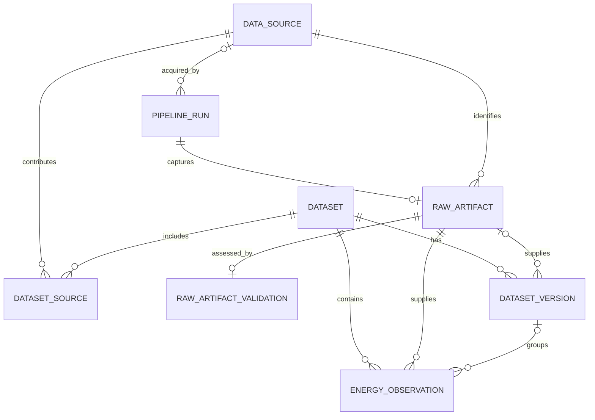
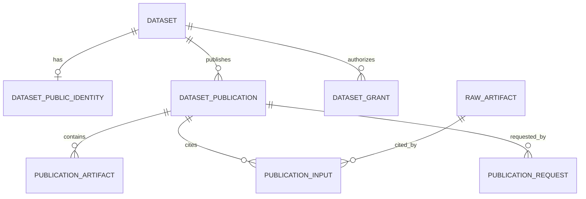

# ODIP database schema

Flyway migrations [V1–V12](../../services/platform-api/src/main/resources/db/migration/) create the PostgreSQL application schema. The tables separate catalog identity, acquisition evidence, curated observations, and consumer publications. Most row identities and relationships use UUIDs; public publication IDs and semantic versions are strings. Flexible metadata and reports use `JSONB`, while acquired and published bytes use `BYTEA`. See the [system model](README.md) for the conceptual flow and the [API model](api.md) for the interfaces over these tables.

## Catalog, acquisition, and curation

The first diagram shows declared foreign-key relationships. A source can contribute to multiple datasets through `dataset_source`. A successful pipeline run has at most one raw artifact; curation can link an artifact to an internal version and annual observations.

| Table | Identity and relationships | Stored meaning and important constraints |
| --- | --- | --- |
| `data_source` | `id` UUID primary key | Unique `name`; source type, external `location`, owner, license, refresh cadence, optional normalizer, and metadata. |
| `dataset` | `id` UUID primary key | Unique `name`; description, owner, and classification. This is the internal dataset identity. |
| `dataset_source` | `(dataset_id, source_id)` primary key; foreign keys to `dataset` and `data_source` | Many-to-many map of contributing sources. Deleting a dataset cascades through this link; deleting a referenced source is restricted. |
| `pipeline_run` | `id` UUID primary key; optional source, dataset, and output-version foreign keys | One execution's status, requested/start/end times, failure reason, configuration, metrics, owning principal, and claim token. The ingestion path uses the source link; some other links are optional in the schema. |
| `raw_artifact` | `id` UUID primary key; unique `pipeline_run_id` foreign key and source foreign key | Captured `payload` bytes, storage URI, content type/length, SHA-256, source version, and retrieval time. The URI identifies PostgreSQL-backed content in current writes; `payload` is nullable to accommodate earlier rows. |
| `raw_artifact_validation` | `id` UUID primary key; unique raw-artifact foreign key | One optional assessment per artifact: `VALID`, `INVALID`, or `UNSUPPORTED`, plus format, record count, schema fingerprint, reason, and validation time. |
| `dataset_version` | `id` UUID primary key; dataset foreign key; optional raw-artifact foreign key | Internal integer `version_number`, status, JSON schema definition, and quality summary. `(dataset_id, version_number)` is unique; `(dataset_id, raw_artifact_id)` is unique when the artifact is present. |
| `energy_observation` | `id` UUID primary key; dataset and raw-artifact foreign keys; optional dataset-version foreign key | Annual indicator/region/unit/value rows. A raw artifact cannot repeat the same indicator, region, year, and unit; years are limited to 1900–2200. |

## Publication, access, and retention

The publication tables attach a public identity, immutable artifacts, input lineage, and per-principal access to an internal dataset. The diagram shows foreign keys only. `dataset_publication.public_dataset_id` is associated with `dataset_public_identity` by application checks, rather than a declared foreign key. Audit references and a publication's manifest `schemaRef` are also not foreign keys.

| Table | Identity and relationships | Stored meaning and important constraints |
| --- | --- | --- |
| `dataset_public_identity` | `public_dataset_id` string primary key; unique dataset foreign key | Binding between a contract-facing ID and one internal dataset. |
| `dataset_publication` | `id` UUID primary key; dataset foreign key | Public ID and semantic version; canonical manifest bytes and digest; `DRAFT`, `VALIDATING`, `FAILED`, or `PUBLISHED` state; creator, idempotency/request digests, claim owner/token/time, result report, and publication time. `(public_dataset_id, version)` and `(creator, idempotency_key)` are unique. |
| `publication_artifact` | `(publication_id, artifact_id)` primary key; publication foreign key | Artifact `BYTEA` payload and SHA-256. Artifacts are identified by the manifest's declared names. |
| `publication_input` | `(publication_id, raw_artifact_id)` primary key; publication and raw-artifact foreign keys | Explicit provenance link to captured source bytes. At draft creation, the service also verifies that each input comes from a source linked to the dataset and has captured bytes. |
| `publication_request` | `(principal_id, idempotency_key)` primary key; publication foreign key | Makes publish requests idempotent for a principal and key. |
| `dataset_grant` | `(dataset_id, principal_id, permission)` primary key; dataset foreign key | Explicit `READ`, `WRITE`, `INGEST`, or `VALIDATE` permission for one stable principal on one dataset. |
| `publication_audit` | `id` UUID primary key | Principal, action, optional dataset/publication IDs, timestamp, and correlation ID. The ID columns are audit references, not declared foreign keys. |
| `publication_support` | `schema_ref` string primary key | Support end time for a publication profile, used to reject newly unsupported drafts and determine publication expiry. |

Application checks and database constraints protect different parts of this model. The service verifies request digests, source-to-dataset lineage, artifact content, and validation evidence. PostgreSQL uniqueness and foreign keys protect identities and links. Triggers prevent updates or deletes to published publication rows, changes to their artifacts and input links, and deletion or changes to the bytes and key provenance of raw artifacts used by a published version.

A recorded profile support end can make a publication eligible for deletion **one year after that end**. Scheduled cleanup removes its publication rows and links; separate audit cleanup removes audit rows older than 180 days. These retention rules do not remove the underlying raw-artifact rows. The relevant definitions are in the [publication](../../services/platform-api/src/main/resources/db/migration/V9__add_dataset_publications.sql), [retention](../../services/platform-api/src/main/resources/db/migration/V11__add_publication_retention.sql), and [raw-input protection](../../services/platform-api/src/main/resources/db/migration/V12__protect_published_raw_inputs.sql) migrations, with cleanup in the [publication service](../../services/platform-api/src/main/kotlin/de/eseidinger/odip/platform/publication/PublicationService.kt).
